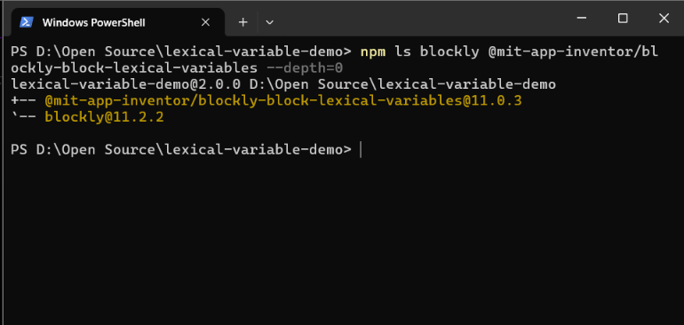
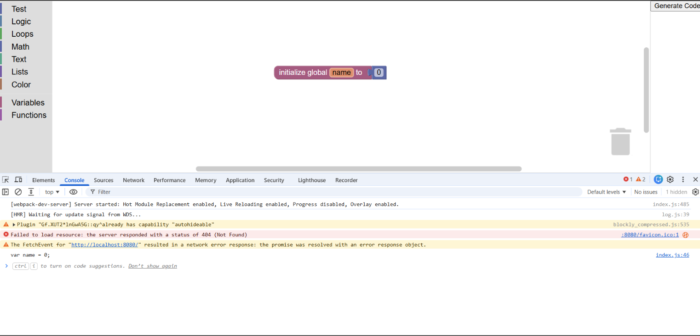

# lexical-variable-demo

[](https://github.com/google/blockly)

A demo of the [Blockly lexical variables plugin](https://github.com/mit-cml/blockly-plugins/tree/main/block-lexical-variables). This project uses Webpack and ES6 modules.

## Prerequisites

- **Node.js 18 or newer** — install it from the [official download page](https://nodejs.org/en/download).
- **npm** — included with Node.js.

Verify your installation in PowerShell:

```powershell
node -v
npm -v
```

The Node.js version should be `v18` or newer.


## Installation

Clone the repository and enter its directory:

```powershell
git clone https://github.com/mit-cml/lexical-variable-demo.git
cd lexical-variable-demo
```

Install dependencies:

```powershell
npm install --legacy-peer-deps
```

The `--legacy-peer-deps` option bypasses strict peer-dependency checks during installation.

This demo uses Blockly `11.2.2` and `@mit-app-inventor/blockly-block-lexical-variables` `11.0.3`.

## Running

Start the development server:

```powershell
npm run start
```

Open [http://localhost:8080](http://localhost:8080).

Select blocks from the toolbox, arrange them in the workspace, and click **Generate Code**. The generated code appears in the browser console.

Press `Ctrl+C` in the terminal to stop the server.

## Build a Deployable Version

Run:

```powershell
npm run build
```

Webpack generates production files in the `docs` directory.

## Windows Troubleshooting

### 1. Node.js or npm is not recognized

- Install Node.js from the [official download page](https://nodejs.org/en/download).
- Close and reopen PowerShell.
- Verify the installation using `node -v` and `npm -v`.

### 2. Dependency installation fails

Try:

```powershell
npm install --legacy-peer-deps
```

Make sure you are in the project directory and `package.json` exists. If installation still fails, inspect the full npm error before changing versions or deleting files.

### 3. Port 8080 is already in use

Check which process is using the port:

```powershell
netstat -ano | findstr :8080
```

The last column shows the process ID (PID). Identify it before stopping anything:

```powershell
tasklist /FI "PID eq <PID>"
```

Replace `<PID>` with the actual process ID. If it is another development server you own, stop it using its terminal with `Ctrl+C`. Alternatively, configure Webpack Dev Server to use another available port.

### 4. `npm run start` fails

- Confirm dependency installation completed successfully.
- Check the terminal for port conflicts and compilation errors.
- Inspect the browser console for client-side errors.

### 5. `npm run build` fails

- Read the first relevant error in the terminal.
- Check for missing dependencies and incompatible package versions.
- Inspect installed Blockly packages with:

```powershell
npm ls blockly @mit-app-inventor/blockly-block-lexical-variables
```

Webpack asset-size warnings do not necessarily mean the build failed. Check whether compilation completed successfully.

## Learn More

- [Blockly](https://developers.google.com/blockly)
- [Webpack](https://webpack.js.org/)
- [Blockly lexical variables plugin](https://github.com/mit-cml/blockly-plugins/tree/main/block-lexical-variables)

## Screenshots

### Blockly Demo

The demo below shows the lexical variables block and generated JavaScript code.



### Verified Dependency Versions

The following screenshot shows the installed Blockly and lexical variables plugin versions.

